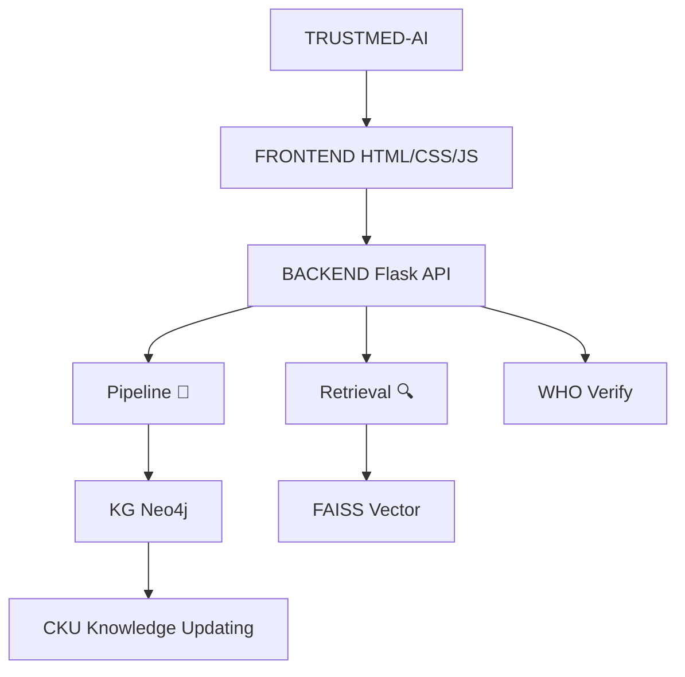

# TrustMed AI

**Knowledge-Intensive Retrieval & Generation System for Healthcare**

---

## 🔍 Overview

TrustMed AI is a hybrid, evidence-grounded healthcare decision-support system that combines:

* **Knowledge Graph (Neo4j)** for structured medical knowledge
* **RAG (Retrieval-Augmented Generation)** for evidence retrieval
* **TrustRank** for evidence filtering and ranking
* **LLM (Gemini + OpenAI fallback)** for controlled answer generation
* **DKU (Dynamic Knowledge Update)** for self-improving knowledge graph
* **Patient profile reasoning** for allergies, medications, chronic conditions, age, lifestyle, and pregnancy status
* **Uncertainty and contradiction checks** before response generation
* **CKU intake** for auditable review of new medical evidence

The system takes **symptoms as input** and outputs:

* Likely diseases
* Recommended drugs
* Trusted medical evidence
* Final explanation (grounded + concise)

---

## 🧠 System Architecture

```
                    TRUSTMED-AI
                         │
                         ▼
                 ┌───────────────┐
                 │   FRONTEND    │
                 │ HTML/CSS/JS   │
                 └───────┬───────┘
                         │
                         ▼
                 ┌───────────────┐
                 │    BACKEND    │
                 │ Flask / API   │
                 └───────┬───────┘
                         │
          ┌──────────────┼──────────────┐
          ▼              ▼              ▼
     ┌─────────┐   ┌───────────┐   ┌─────────┐
     │Pipeline │   │ Retrieval │   │ WHO     │
     │   🧠    │   │   🔍      │   │ Verify  │
     └────┬────┘   └─────┬─────┘   └─────────┘
          │              │
          ▼              ▼
     ┌─────────┐    ┌─────────┐
     │   KG    │    │  FAISS  │
     │ Neo4j   │    │ Vector  │
     └─────────┘    └─────────┘
          │
          ▼
     ┌──────────────┐
     │     CKU      │
     │ Knowledge    │
     │   Updating   │
     └──────────────┘
```



## Runtime endpoints

* `GET /` — TrustMed AI web interface with document upload and patient profile fields
* `POST /api/analyze` — symptom analysis; accepts optional `patient_profile`
* `POST /api/analyze-document` — multipart document analysis with optional JSON `profile`
* `GET /api/cku/candidates` — list pending evidence candidates
* `POST /api/cku/candidates` — submit new evidence for explicit review before knowledge-base promotion

Responses include `patient_profile`, `reasoning_trace`, evidence sufficiency, contradictions, drug exclusions, RAG evidence, and interactions. CKU records are queued for review and are not silently written into Neo4j.

---

## 📁 Project Structure

```
FACT_GEN_HEALTH/
│
├── data/
│   ├── raw/
│   │   ├── medquad/
│   │   ├── drugs/
│   │   └── symptoms/
│   ├── processed/
│   └── vector_store/
│
├── pipeline/
│   ├── full_pipeline.py
│   ├── query_engine.py
│   ├── trust_rank.py
│   └── generator.py
│
├── retrieval/
│   └── rag_retriever.py
│
├── scripts/
│   ├── process_medquad.py
│   ├── build_vector_store.py
│   ├── test_rag.py
│   ├── test_trustrank.py
│   ├── test_pipeline.py
│   └── run_full_evaluation.py
│
├── config/
│   └── settings.py
│
├── utils/
│   └── (optional helpers)
│
├── .env
├── requirements.txt
└── README.md
```

---

## ⚙️ Setup Instructions

### 1️⃣ Clone & Environment

```bash
git clone <your-repo>
cd FACT_GEN_HEALTH
python -m venv venv
venv\Scripts\activate   # Windows
```

---

### 2️⃣ Install Dependencies

```bash
pip install -r requirements.txt
```

**Key libraries:**

* neo4j
* sentence-transformers
* faiss-cpu
* pandas
* python-dotenv
* google-generativeai
* openai

---

### 3️⃣ Configure Environment Variables

Create `.env`:

```env
GEMINI_API_KEY=your_gemini_key
OPENAI_API_KEY=your_openai_key
```

---

### 4️⃣ Configure Neo4j

In `config/settings.py`:

```python
NEO4J_URI = "bolt://localhost:7687"
NEO4J_USER = "neo4j"
NEO4J_PASSWORD = "your_password"
```

Start Neo4j Desktop / AuraDB.

---

## 🧬 Step-by-Step Pipeline Execution

---

# 🧩 STEP 1 — Prepare Dataset

### Input:

```
data/raw/medquad/medquad.jsonl
```

### Run:

```bash
python -m scripts.process_medquad
```

### Output:

```
data/processed/medquad.json
```

---

# 🧠 STEP 2 — Build Vector Store (RAG)

```bash
python -m scripts.build_vector_store
```

### Output:

```
data/vector_store/medquad.faiss
data/vector_store/medquad_map.json
```

---

# 🔍 STEP 3 — Test RAG

```bash
python -m scripts.test_rag
```

### Purpose:

* Validate retrieval quality
* Check relevant evidence

---

# 🧠 STEP 4 — Test TrustRank

```bash
python -m scripts.test_trustrank
```

### Purpose:

* Rank evidence
* Remove noise

---

# 🧠 STEP 5 — Build Knowledge Graph (Neo4j)

Load disease–symptom and disease–drug data into Neo4j.

### Example:

```cypher
MERGE (d:Disease {name: "diabetes"})
MERGE (s:Symptom {name: "fatigue"})
MERGE (d)-[:HAS_SYMPTOM]->(s)

MERGE (dr:Drug {name: "metformin"})
MERGE (d)-[:TREATED_BY]->(dr)
```

---

# 🚀 STEP 6 — Run Full Pipeline

```bash
python -m scripts.test_pipeline
```

---

## 🔄 What Happens Internally

---

### 1. Disease Detection

```
SymptomQueryEngine → top diseases
```

---

### 2. KG Drug Retrieval

```
MATCH (Disease)-[:TREATED_BY]->(Drug)
```

---

### 3. Drug Validation

* Removes CID / noise
* Filters invalid tokens

---

### 4. LLM Fallback (if KG fails)

```
Gemini → OpenAI fallback
```

Extracts:

```
metformin, insulin, glipizide
```

---

### 5. DKU (Dynamic Knowledge Update)

```cypher
MERGE (d:Disease)
MERGE (dr:Drug)
MERGE (d)-[:TREATED_BY {source:"DKU"}]->(dr)
```

---

### 6. RAG Retrieval

```
FAISS search → top documents
```

---

### 7. TrustRank

Ranks based on:

* relevance
* disease match
* keyword signals

---

### 8. Final Generation

LLM generates:

* short explanation
* treatment
* safety note

---

## 📊 Evaluation

Run:

```bash
python -m scripts.run_full_evaluation
```

---

### Metrics Used

* Precision@5
* Recall@5
* F1@5
* MRR
* nDCG
* Faithfulness
* Content relevance
* Full Q² QA score: questions generated from the answer and verified against retrieved evidence
* Hallucination Rate
* Latency
* Enrichment Usage

---

## 🔁 Dynamic Knowledge Update (DKU)

DKU enables:

* automatic correction of missing KG knowledge
* insertion of new drug relationships
* continuous learning

---

## ⚠️ Common Issues & Fixes

---

### ❌ No drugs found

✔ Fix:

* KG missing relationships
* ensure `TREATED_BY` exists

---

### ❌ Wrong drugs

✔ Fix:

* validation layer removes noise
* Gemini replaces incorrect KG

---

### ❌ Empty Gemini output

✔ Fix:

* ensure API key is correct
* check `.env` loading

---

### ❌ Module errors

✔ Fix:

```bash
pip install -r requirements.txt
```

---

## 🧠 Key Contributions

* Hybrid KG + RAG architecture
* TrustRank-based evidence filtering
* Dynamic Knowledge Update (DKU)
* Multi-model fallback (Gemini + OpenAI)
* Robust medical retrieval system

---

## 🚀 Future Improvements

* Drug ranking (best-first)
* Interaction-aware filtering
* Confidence scoring
* Multi-hop KG reasoning

---

## 📌 Conclusion

FACT-GEN-HEALTH demonstrates how structured knowledge and generative AI can be combined to build a **robust, explainable, and adaptive healthcare retrieval system**.

---

## 👨‍💻 Authors

* Your Name
* Project: Major Project (Healthcare AI System)

---
